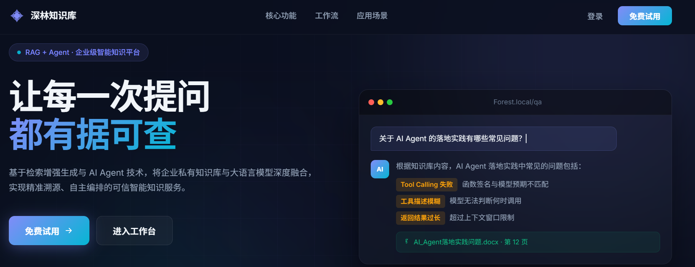
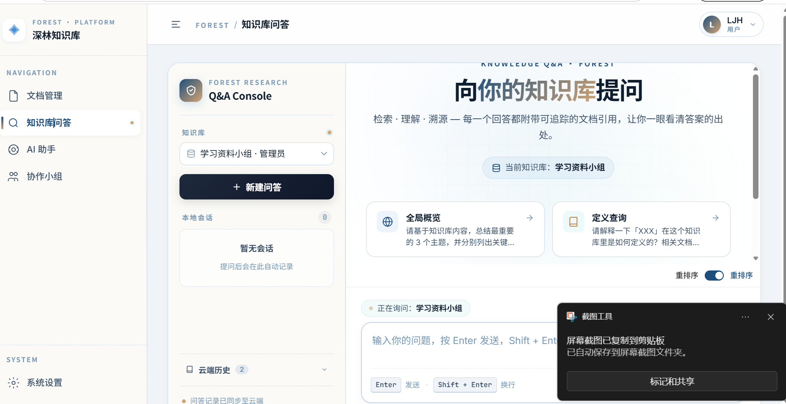
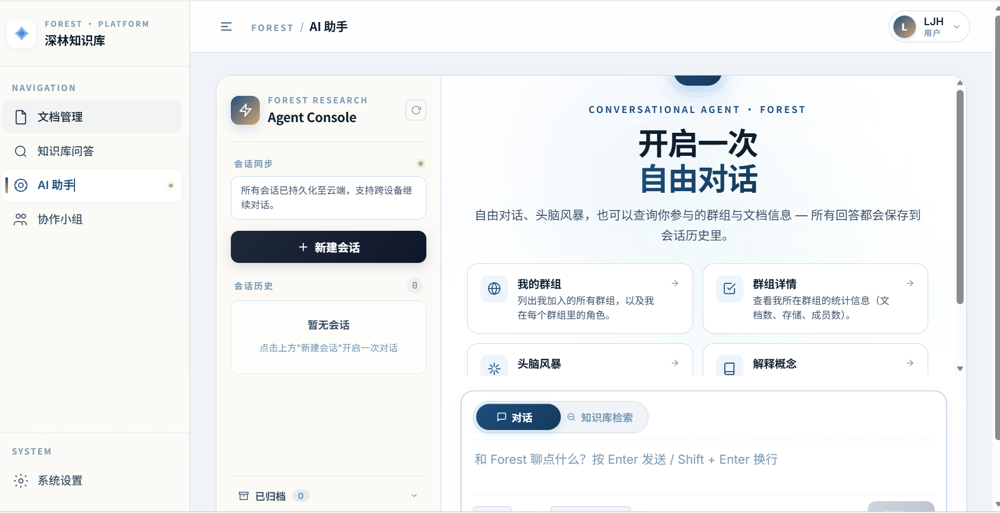
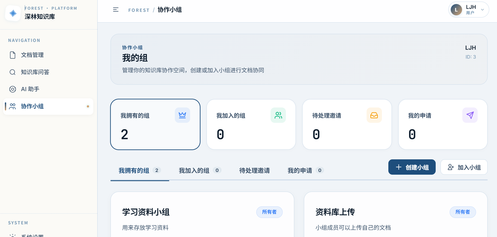

<div align="center">


</div>

<br/>

<h1 align="center">forest — 企业级 RAG 知识库平台</h1>

<p align="center">
  <strong>基于检索增强生成 (RAG) 的企业智能知识管理系统</strong>
</p>

<p align="center">
  📄 多格式文档解析 &nbsp;·&nbsp; 🔍 混合检索引擎 &nbsp;·&nbsp; 💬 AI 智能对话 &nbsp;·&nbsp; 📊 全链路可观测
</p>

---

## 概述

forest 是一款专为组织设计的**企业级知识库解决方案**，核心能力包括：

| 能力维度 | 说明 |
|---------|------|
| **智能问答** | 基于 RAG 技术的精准知识检索与生成 |
| **文档管理** | 支持 PDF/DOCX/MD/TXT 的多格式解析与存储 |
| **AI 助手** | 具备记忆能力的对话式智能体 |
| **团队协作** | 群组隔离、权限管控的协作机制 |
| **运维监控** | 完整的管理控制台与审计能力 |

---

## 技术架构

### 后端服务

```
┌─────────────────────────────────────────────────────────────┐
│                     forest-python                           │
├─────────────┬──────────────┬──────────────┬────────────────┤
│  FastAPI    │  SQLAlchemy  │   LangGraph  │  Pydantic v2   │
│  异步框架    │  ORM + 异步   │  Agent 框架  │  数据验证       │
└─────────────┴──────────────┴──────────────┴────────────────┘
        │              │              │
        ▼              ▼              ▼
  ┌─────────┐   ┌──────────┐   ┌──────────┐
  │ PG 16   │   │ ES 8.x   │   │  MinIO   │
  │ pgvector│   │ IK分词   │   │ 对象存储  │
  └─────────┘   └──────────┘   └──────────┘
```

**核心技术栈**：
- **运行时**: Python 3.12 / FastAPI 异步服务
- **数据存储**: PostgreSQL 16 (HNSW向量) + Elasticsearch 8.x (全文检索)
- **对象存储**: MinIO (S3 兼容)
- **AI 引擎**: LangGraph Agent + 多模型支持

### 前端应用

```
┌─────────────────────────────────────────────────────────────┐
│                    forest-frontend                          │
├─────────────────────────────────────────────────────────────┤
│  Vue 3 (Composition API) + TypeScript + Vite 8              │
│  Element Plus UI · Pinia 状态 · Axios · KaTeX 公式渲染       │
└─────────────────────────────────────────────────────────────┘
```

**前端技术栈**：
- **框架**: Vue 3.5 + TypeScript + Vite 8
- **UI 库**: Element Plus (中文本地化)
- **状态管理**: Pinia
- **特殊渲染**: KaTeX + DOMPurify (公式与安全)

---

## 功能特性

### 一、知识库问答

```
提问 → 查询规划(LLM) → 并行检索(向量+关键词) → 融合排序 → 证据评估 → 生成回答
```

- **四级证据评估**：SUFFICIENT / PARTIAL / WEAK / NONE
- **主动拒答**：证据不足时直接告知，避免幻觉
- **云端历史**：自动保存问答记录，支持续聊与追溯

### 二、AI 智能助手

- **ReactAgent 引擎**：自主决策是否调用检索工具
- **语义记忆**："AI 记住了什么"可视化卡片
- **会话管理**：归档、恢复、游标分页
- **流式输出**：真 SSE 流式响应，打字机效果

### 三、文档管理

| 特性 | 说明 |
|-----|------|
| 多格式支持 | PDF / DOCX / MD / TXT |
| 深度解析 | Docling 引擎处理复杂版面 |
| 智能切片 | 结构化切块 + 向量化 |
| 去重机制 | SHA-256 同群去重 |
| 断点续传 | 分片上传 + 秒传 |

### 四、协作小组

- 群组创建与成员邀请
- 申请/审批流程
- 实时角标提醒
- 群组级数据隔离（向量检索 + ES 检索双重过滤）

### 五、管理控制台

```
┌─────────────────────────────────────────────────────────────┐
│                      管理员视图                              │
├──────────────┬──────────────┬──────────────┬────────────────┤
│  文档总览    │  群组管理    │  问答历史    │   系统健康     │
├──────────────┼──────────────┼──────────────┼────────────────┤
│  数据洞察    │  审计日志    │  用户管理    │   LLM 用量统计  │
└──────────────┴──────────────┴──────────────┴────────────────┘
```

**关键能力**：
- 跨群组文档状态统计
- 检索质量分布分析
- 敏感操作审计留痕
- 模型动态切换配置

---

## 项目截图

| 首页 | 知识库问答 | AI 助手 | 协作小组 |
|------|-----------|---------|---------|
|  |  |  |  |

---

## 快速部署

### 前置要求

- Docker + Docker Compose
- Node.js 20+ / Python 3.12+

### 一键启动

```bash
# 1. 启动基础服务
docker compose up -d

# 2. 配置后端环境变量
cd forest-python
cp .env.example .env
# 编辑 .env 填入 API Key

# 3. 初始化数据库
pip install -r requirements.txt
python init_db.py

# 4. 启动后端
uvicorn app.main:app --host 0.0.0.0 --port 10001 --reload

# 5. 启动前端
cd ../forest-frontend
npm install
npm run dev
```

访问 **http://localhost:5888**，默认管理员：`admin` / `Admin@123456`

---

## 目录结构

```
forest/
├── docker-compose.yml          # 基础设施编排
├── forest-python/              # 后端服务
│   ├── app/
│   │   ├── main.py            # 应用入口
│   │   ├── config.py          # 配置加载
│   │   ├── auth/              # 认证授权
│   │   ├── user/              # 用户管理
│   │   ├── group/             # 群组协作
│   │   ├── document/          # 文档管理
│   │   ├── ingestion/         # ETL 流水线
│   │   ├── qa/                # 知识库问答
│   │   ├── assistant/         # AI 助手 Agent
│   │   ├── metrics/           # 数据洞察
│   │   ├── models_config/     # 模型配置
│   │   ├── audit/             # 审计日志
│   │   ├── system/            # 系统健康
│   │   └── engine/            # 基础设施层
│   ├── init_db.py             # 数据库初始化
│   ├── pyproject.toml         # 依赖配置
│   └── .env.example           # 环境变量模板
│
└── forest-frontend/            # 前端应用
    └── src/
        ├── api/               # API 封装
        ├── views/             # 页面组件
        │   ├── documents/     # 文档管理页
        │   ├── qa/            # 问答页
        │   ├── assistant/     # 助手页
        │   ├── groups/        # 协作页
        │   ├── admin/         # 管理后台
        │   └── settings/      # 系统设置
        ├── stores/            # 状态管理
        ├── utils/             # 工具函数
        └── components/        # 公共组件
```

---

## 扩展与定制

### 支持的大模型

| 模型类型 | 支持列表 |
|---------|---------|
| 聊天模型 | DeepSeek, Claude, GPT, Gemini, Qwen, GLM, Grok 等 |
| 嵌入模型 | text-embedding-v4, nomic-embed-text, bge-m3 等 |
| 重排序 | gte-rerank-v2 |

所有模型均可通过管理控制台动态切换，无需重启服务。

### 插件化架构

- **解析器**：MinerU / Markdown / 文本解析器可插拔
- **向量存储**：PostgreSQL pgvector 为主，可扩展其他向量库
- **全文检索**：Elasticsearch，支持自定义分词器

---

## 相关文档

- [启动指南](STARTUP.md) — 完整部署与配置说明
- [需求文档](docs/需求文档.md) — 功能需求规格
- [设计文档](docs/设计文档.md) — 系统架构设计
- [修复报告](docs/代码审查修复报告.md) — 问题追踪与修复日志

---

## 许可证

本项目采用 [MIT 许可证](LICENSE)。

---

<div align="center">

**森林之中，万物互联** — 让知识在组织中自然生长 🌲

</div>
